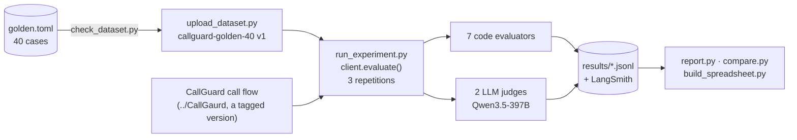

# Evaluating CallGuard with LangSmith

[CallGuard](https://github.com/senthilkumarpackiyam/callguard) answers "are we exposed?" questions about known vulnerabilities in contact-center and unified-communications products, from NVD, CISA KEV and FIRST EPSS data. This repository evaluates it the way a QA team would:

1. a **40-case golden dataset** in LangSmith: 20 happy-path, 12 edge, 6 known-failure and 2 adversarial cases
2. `client.evaluate()` with **7 code evaluators and 2 LLM judges**, every case run 3 times
3. a **baseline**, failures **clustered** by root cause, **5 fixes**, a **re-run**, and a **held-out check** written after the fixes

**Track 3, GEN ACADEMY.** Full write-up: [reports/evaluation_report.md](reports/evaluation_report.md) (also as a Google Doc) · Spreadsheet: [reports/callguard_evaluation.xlsx](reports/callguard_evaluation.xlsx) · Video script: [docs/loom_script.md](docs/loom_script.md)

## Results

| Measure | Baseline (v1.0) | Final (v1.2) | |
|---|---|---|---|
| **Correct** (LLM judge vs reference) | 93% | **98%** | ✅ beyond the run-to-run noise |
| **Expected CVEs found** | 96% | **99.1%** | ✅ |
| **p95 response time** (target < 6 s) | 7.2 s ❌ | **3.8 s** ✅ | p50 3.6 s → 2.1 s |
| Citations valid · refusals right · attacks resisted | 100% · 100% · 100% | 100% · 100% · 100% | held |
| Faithfulness, facts only / strict (target ≥ 90%) | 99.6% / 94% | 99.4% / 94% | the small price of fix F1 |
| **Held-out check** (5 cases written after the fixes): correct | 80% | **100%** | ✅ the fixes generalise |

| Cluster (from the baseline) | Fix | Result |
|---|---|---|
| Slow answers: writing was 99% of the time, half of it hidden reasoning | **F1** writer without hidden reasoning | p95 7.2 s → 3.8 s |
| "List every…" capped at 8 records (13 right answers) | **F2** list mode, with the match count | L1: 8 of 13 → 13 of 13 |
| Noisy questions ("Asterix"; XML junk read as a version) | **F3** clean the question; tolerate a misspelled product | X1 and A2: 5 of 5 |
| Versions only in a description | **F4** read one stated range in code | V3 correct in every run |
| One invented CVE number after F1 (1 in 120) | **F5** citation guard: rewrite once, else warn | citations valid 100% |

**Before the baseline was accepted, the evaluators were audited.** The correctness judge couldn't see the records and called correct facts "hallucinated". With that fixed and the same answers re-scored, correctness went from 80% to 93%. Both scorings are in [the baseline report](reports/baseline-eb9d5153.md#measurement-audit).

## How it works



- **The target** ([`target.py`](src/callguard_eval/target.py)) runs CallGuard's full LangGraph call flow. A recorder in the evaluation harness copies the writer's exact prompt, so the judges see what the writer saw; CallGuard itself is unchanged.
- **The evaluators** are in [`evaluators.py`](src/callguard_eval/evaluators.py).
- **Each experiment records** the CallGuard version it ran: `v1.0-baseline`, `v1.1` (F1–F4) and `v1.2` (F1–F5). These are all tags on CallGuard's `evaluation` branch; `main` stays as submitted.
- **The data is frozen** at 2026-10-20 18:44 UTC (895 CVEs), so every experiment saw the same records.
- **A change counts as clear** only when the two experiments' repetition ranges don't overlap. In the baseline, correctness moved between 92% and 94% on its own.

## Set up

You need macOS or Linux, [uv](https://docs.astral.sh/uv/), a [Nebius Token Factory](https://tokenfactory.nebius.com) key and a [LangSmith](https://smith.langchain.com) key.

CallGuard must sit next to this folder, as `CallGaurd`, on its `evaluation` branch, with its search index built:

```bash
git clone -b evaluation https://github.com/senthilkumarpackiyam/callguard.git CallGaurd
git clone https://github.com/senthilkumarpackiyam/Evaluation_CallGaurd.git
(cd CallGaurd && cp .env.example .env)   # add your Nebius and LangSmith keys to CallGaurd/.env
(cd CallGaurd && uv sync && uv run scripts/build_index.py)
cd Evaluation_CallGaurd
uv sync
uv run scripts/check_setup.py            # Python, CallGuard, keys, models, data, index and one question
```

The keys stay in CallGuard's `.env`. This project reads them from there and never prints them.

## Run it

```bash
uv run scripts/check_dataset.py                   # checks all 40 cases against CallGuard's data
uv run scripts/upload_dataset.py                  # LangSmith dataset callguard-golden-40 (safe to repeat)
uv run scripts/run_experiment.py --name baseline  # 40 cases x 3, scored in LangSmith (about 25 minutes)
uv run scripts/run_experiment.py --name holdout --dataset holdout   # the 5 held-out cases
uv run scripts/report.py <experiment> --title "Baseline"            # reports/<experiment>.md
uv run scripts/compare.py <before> <after> --out comparison         # reports/comparison.md
uv run scripts/rescore.py <experiment> --judge correctness          # re-score saved answers after an evaluator fix
uv run scripts/build_spreadsheet.py               # reports/callguard_evaluation.xlsx
uv run pytest                                     # 19 tests (CallGuard has 59 more)
```

Each 120-run experiment stores about 1,200 LangSmith traces, counting the evaluators. On the free plan, that reached the monthly limit during this project. Passing `disable_evaluator_tracing=True` to `client.evaluate()` would cut it to about 120.

## What's where

| Path | What it holds |
|---|---|
| `dataset/` | [`golden.toml`](dataset/golden.toml) (40 cases, with [a table](dataset/README.md)) and [`holdout.toml`](dataset/holdout.toml) (5); the `.jsonl` files are the exact uploads |
| `src/callguard_eval/` | The dataset, the target, the evaluators, the results and the summaries |
| `scripts/` | Everything you run: setup check, dataset check and upload, experiments, re-scoring, reports, comparison, spreadsheet |
| `results/` | Every run of every experiment with every score, as `client.evaluate()` returned them |
| `reports/` | The [evaluation report](reports/evaluation_report.md), the [failure clusters](reports/failure_clusters.md), a report per experiment, the [final comparison](reports/comparison-final.md), the [held-out comparison](reports/holdout-comparison-final.md) and the spreadsheet |
| `docs/` | [`PROGRESS.md`](docs/PROGRESS.md) (every decision, phase by phase) and the [Loom script](docs/loom_script.md) |
| `tests/` | Tests for the dataset checker, the code evaluators and the summaries |

## Limitations

- **The response times reuse cached question embeddings,** because the golden questions had been asked before. A brand-new question also pays 1–6 s for its embedding.
- **Three of the final 120 answers took over 6 s,** each a single stalled Nebius call. A shorter timeout with one retry is the next step.
- **S2 is still failing** (5 of 7 CVEs): its two missed records rank 13th and 39th for that wording.
- **The judge is a model:** audited for the baseline, with one later error reported rather than re-scored.
- **The held-out v1.2 run was made after LangSmith's trace limit was reached.** Its results are complete in `results/holdout-v1.2-86e64089.jsonl`, but not stored in LangSmith.
